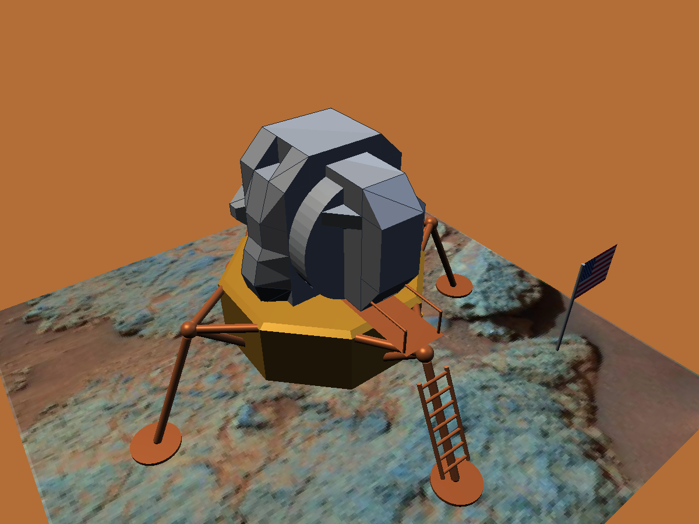
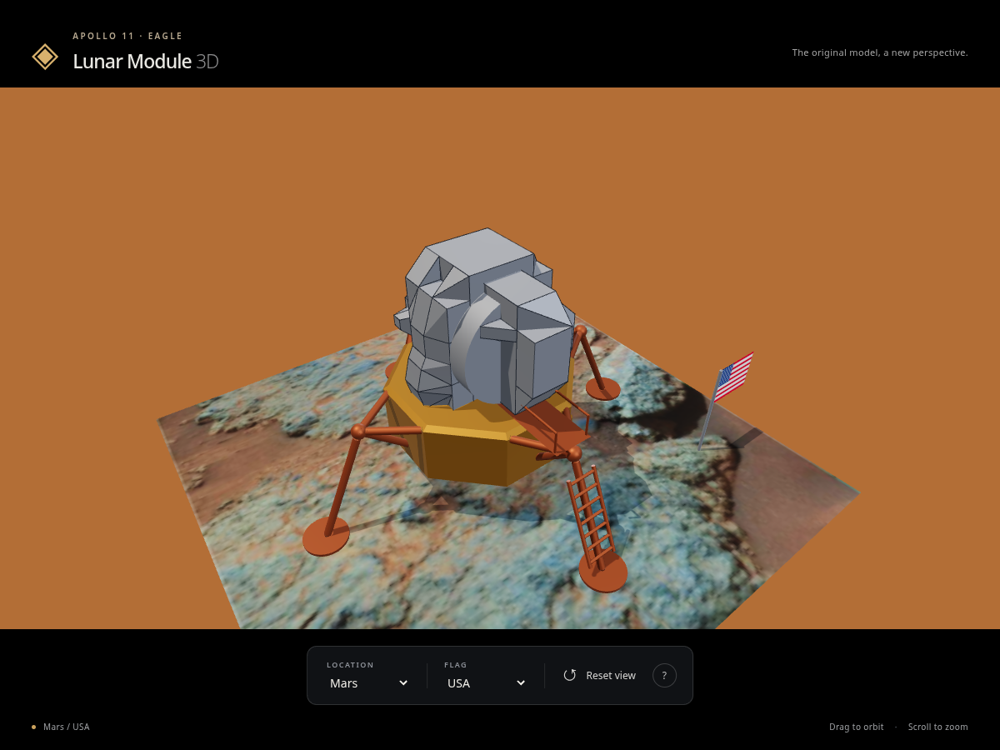
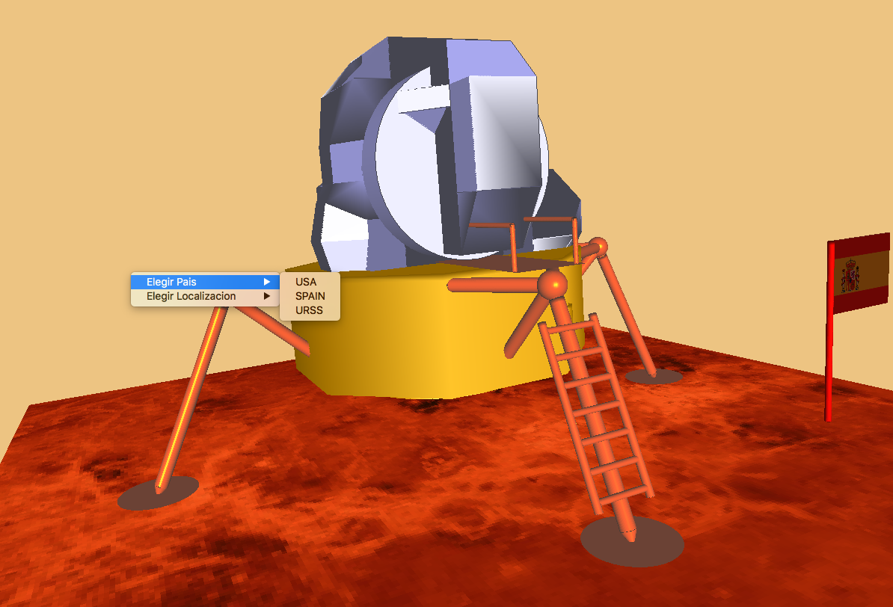
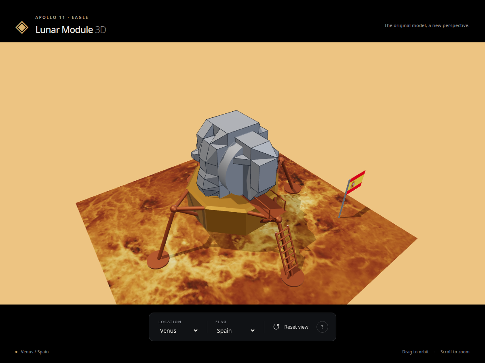

# Lunar Module 3D

An interactive Apollo 11 lunar module model, originally created as a computer graphics coursework project in 2007. [Try the live HTML version](https://lunar-module-3d.vercel.app/) in your browser.

This repository contains two implementations:

| | Core version | HTML version |
| --- | --- | --- |
| Purpose | Refactored original desktop application | New browser implementation of the same model |
| Technology | C, OpenGL, GLU, GLUT/freeglut | TypeScript, Three.js, Vite, WebGL 2 |
| Source | `src/` | `html/src/` |
| Run | Compile with Make | Open in a browser or run with Vite |

Both show the cabin, gold base, landing legs, ladder, ramp, and flag. Choose Moon, Mars, or Venus terrain and a USA, Spain, or USSR flag independently.

## Screenshots

The same terrain and flag choices rendered by the refactored C/OpenGL application and the new HTML viewer.

| Scene | Core — refactored desktop | HTML — new browser viewer |
| --- | --- | --- |
| Mars / USA |  |  |
| Venus / Spain |  |  |

## Core version — refactored C/OpenGL

The original application has been reorganized and simplified, with geometry and lighting improvements. It remains a native desktop program using the original OpenGL rendering approach.

Requires a C compiler, GNU Make, OpenGL, GLU, GLUT/freeglut, and a graphical desktop. On Debian/Ubuntu, install the dependencies with:

```sh
sudo apt install build-essential pkg-config freeglut3-dev libgl1-mesa-dev libglu1-mesa-dev
```

Build and run from the repository root:

```sh
make
./lunar-module
```

Left-drag to rotate, middle-drag to zoom, and Shift + middle-drag to pan. Right-click to choose terrain or a flag. Escape quits.

Generated objects go in `build/`. Run `make clean` to remove them and the executable. The Makefile also includes macOS build paths; macOS compatibility has not been verified.

## HTML version — new TypeScript/Three.js viewer

The live version needs no installation, only a browser with WebGL 2 support.

This is a separate browser implementation, not the C application embedded in a webpage. It preserves the model's geometry and colors while adding modern materials, shadows, touch controls, and reset view.

To run locally, use Node.js 22.12 or newer:

```sh
cd html
npm ci
npm run dev
```

Open the address printed by Vite, normally `http://127.0.0.1:5173/`.

Left-drag to orbit, scroll or middle-drag to zoom, and right-drag to pan. On touch screens, use one finger to orbit and two to zoom or pan. Use the visible selectors to change terrain or flag, **Reset view** to restore the camera, and **?** for all controls. The browser camera stays upright; the core version uses free trackball rotation.

To build and preview the static website, run from `html/`:

```sh
npm run build
npm run preview
```

Deploy the generated `html/dist/` contents to a static host such as Vercel. No backend is needed. Use an HTTP/HTTPS server rather than opening `index.html` directly.

## Shared assets and project layout

Both versions load the same TGA textures from `assets/textures/`. There is no second source asset collection inside `html/`; textures are bundled into the generated browser build when needed.

```text
src/              Refactored core application in C
Makefile          Core build commands
html/             New TypeScript/Three.js browser application
assets/textures/  Shared terrain and flag textures
assets/images/    Core and HTML version screenshots
```

Keep `assets/` alongside `html/` for local development. If the core cabin geometry changes, run `npm run import-model` from `html/` to regenerate `html/src/cabin-data.json`. Other browser model parts are maintained in `html/src/model.ts`; native changes are not automatically synchronized.
